## The question the sweep asks

- The programme tests a thermal subgrid closure where it has not been tested a posteriori: at high and at low Prandtl number.
- In doing so it maps the heat transfer and the large-scale flow of a periodic-span box over seven decades of the Rayleigh number and seven of the Prandtl number: Pr 0.001 to 10⁴, Ra 10⁵ to 10¹⁰.
- Where no direct simulation of the same geometry exists, the reference is the Grossmann–Lohse theory (Grossmann and Lohse 2000) with the coefficients of Stevens, van der Poel, Grossmann and Lohse 2013, fit S2, called **the GL fit** below. The sweep asks where that fit holds for this cell.
- Of the 617 rows of the case table, 311 carry a verdict of the convergence ladder (judge table of 2026-10-26); **155 current-settings rows on the resolved mesh** form the evidence shown here.
- Twelve findings follow, each with its evidence, our confidence and the question we would like your opinion on. Every number is the one report 09 of the study (revision 2, 2026-10-26) holds, generated from the judge table; nothing was computed for the slides.

## The flow and the cell

- Rayleigh–Bénard convection: a fluid layer of height H heated from below.
- The Prandtl number Pr = ν/κ is the ratio of viscosity to buoyancy diffusivity; the Rayleigh number Ra = Δb H³/(νκ) the ratio of buoyancy forcing to diffusion, with Δb the buoyancy difference between the plates; the Nusselt number Nu the total vertical heat flux over the conductive flux.
- Free-fall units: H = 1, Δb = 1, the free-fall velocity and time t_f equal one, ν = (Pr/Ra)^½ and κ = (Ra Pr)^−½.
- The cell is a unit box (aspect ratio one): isothermal no-slip plates at z = 0 and 1, adiabatic no-slip side walls at x = 0 and 1, and a **periodic direction y** of period H.
- The large-scale circulation can be a single roll whose axis lies along y, braked by no end wall, or a weaker flow of several cells.
- The group's earlier OpenFOAM campaign used a closed cube; its model-free simulation at (Pr, Ra) = (0.1, 10⁷) appears in finding 11.

## Numerics and closure

- Oceananigans.jl, version 0.111 with the project's edits (the corrected rows of finding 12 run on 0.114): the Boussinesq equations on a staggered grid, second-order centred advection and the symmetry-preserving momentum flux of Verstappen and Veldman 2003, so the scheme adds no numerical dissipation.
- Second-order Adams–Bashforth time stepping with variable-step coefficients; a Fourier–tridiagonal pressure solver; the step obeys the advective Courant limit 0.35 and a cell-local diffusive bound.
- The closure is the anisotropic minimum-dissipation model (Rozema et al. 2015) with a per-tracer eddy diffusivity, called **bwamd**: constant C = 1/12 on the filter width the discretisation imposes (a box filter twice the cell wide); the buoyancy term on; the eddy viscosity bounded below by −ν, so backscatter is admitted down to the molecular level; both eddy coefficients zero on the wall faces.
- A **no-model control** is the same run with C = 0, a model-free simulation on the same grid.

## The strict criteria mesh and the convergence ladder

::: {.small}
- One mesh rule for every row of the evidence: a uniform square horizontal grid of N_h × N_h cells; a tanh-stretched vertical grid with at least max(8, 0.35 Ra^0.15) cells inside the thermal boundary layer δ_th and max(8, 0.31 Ra^0.15) inside the kinetic layer δ_u (the counts of Shishkina, Stevens, Grossmann and Lohse 2010); a bulk cell no larger than π times the Kolmogorov length (Pr ≤ 1) or the Batchelor length (Pr > 1) at the reference Nu; a horizontal cell no larger than the thinner of the two reference layers (δ_th = 1/(2 Nu_ref); δ_u from the Prandtl–Blasius estimate).
- Typical grids: 32×32×48 at (7, 10⁶), 48×48×80 at (7, 10⁷), 80×80×160 at (7, 10⁸), 160×160×320 at (7, 10⁹), 448×448×768 at (0.71, 10¹⁰).
- Two coarser families, a relaxed bulk rule above two million cells and meshes mapped from the OpenFOAM campaign, were withdrawn on 2026-10-10 and serve only as comparison data (finding 4).
- Every closure run starts from a developed field of a no-model run on the same grid or a coarsened one. Its averaging window is at least 200 t_f and is judged by the ladder: an overshoot test on the running mean; **Check A**, stationarity gated on the window's own sampling error; **Check A2**, flatness of the time-mean heat-flux profile Nu(z) within 3 %; **Check B**, deviation from the reference within 3 % widened by the reference's spread; **Check C**, the dissipation estimators within 5 % of the wall value.
- A row that fails Check A is extended in 200 t_f steps, so the windows at Pr ≥ 50 reach up to 1600 t_f. Since 2026-10-23 Check A can pass **with a caveat** (pass*): a drift beyond its noise but below the fixed 1 %, or a window the user accepted after reading the volume budget (next slide); such windows are drawn filled with a dark edge and marked * in the tables.
:::

## Measured quantities and references

::: {.small}
- **Nu_wall**: the mean of the two plate fluxes in conductive units. The sampling error of a window mean is δNu = σ √(2 τ_I / T), with σ the standard deviation of the plate-mean series over the window of length T and τ_I its integral time, quoted in per cent of Nu_wall. The stationary rows used here carry 0.01 to 0.96 %.
- **Wind**: the plane-mean horizontal velocity ⟨u⟩_xy(z) along the side-wall direction; U_w is its largest value in the lower half of the cell and **Re_w** = |U_w| H/ν the wind Reynolds number. It is a plane mean, three to five times smaller than Reynolds numbers built on a peak velocity.
- **Re_γ** = |γ| H²/(2ν), the core shear-rate Reynolds number of Grossmann and Lohse 2002, with γ the slope of the time-mean longitudinal velocity on the vertical centreline over |z − ½| < ¼ (Qiu and Tong 2001); **Re_GL** is the theory's value at the same (Pr, Ra).
- **State of the mean flow**, read three ways: the antisymmetry of ⟨u⟩_xy about mid-height (the ladder's label, ROLL when at least 85 % of the mean-square profile is antisymmetric); the share of the (1,1) mode in the Fourier decomposition of the y-averaged streamfunction; and the extreme of that streamfunction, |ψ|max.
- **Layers** from each run's own window-mean profiles: δ_th from the slope of the mean buoyancy at the plate, δ_u by the slope method on the root-mean-square horizontal velocity. **D_w** = ν Δt/Δz_w² is the viscous diffusion number of the wall cell (finding 12).
- **Reference tiers**: where a direct simulation of a closed cube exists at the same (Pr, Ra), it is the reference: Xu, Xi and Xia 2019 at Pr 0.7 and 7 for Ra 10⁶, 3×10⁶ and 10⁷, and Soucasse et al. 2019 at (0.707, 10⁷), seven points. Elsewhere the GL fit, calibrated on cylinders of aspect ratio one, which reads 4.5 to 10.7 % above the seven cube points (mean +7.3 %). "Deviation" means Nu_wall/Nu_ref − 1 with this tier rule; a comparison with the fit is written "against GL".
:::

## Stationarity: why a plate imbalance beyond its noise is not a drift of the plate flux

::: {.small}
- For the resolved field the volume integral of the buoyancy equation is exact (isothermal plates, adiabatic side walls, periodic span, eddy diffusivity zero on the wall faces):

$$\frac{d\langle b\rangle_V}{dt} = \kappa\,(Nu_{bot} - Nu_{top}), \qquad \kappa = (Ra\,Pr)^{-1/2},$$

- with ⟨b⟩_V the volume-mean buoyancy. A plate imbalance is the cell's mean buoyancy still relaxing to its stationary value; the plate mean (Nu_bot + Nu_top)/2, which the ladder judges, does not see it to first order: a shift of ⟨b⟩_V raises one plate's gradient and lowers the other's by the same amount.
- Measured on the judged windows from the solver's own outputs (the 5 t_f window-mean profile b(z) and the plate fluxes of the trace): for the accepted rows (50, 10⁶) 463 and (345, 10⁶) 233 the plate fluxes predict the change of ⟨b⟩_V to 3×10⁻⁴ % and 5×10⁻⁴ %; ⟨b⟩_V − ½ relaxes with e-folding times of 375 and 483 t_f; the plate mean moves by +0.03 % and −0.006 % between the half-windows while the two plates move in opposite directions (bottom −0.05 %, top +0.11 %; bottom +0.02 %, top −0.04 %).
- For (2.5, 10⁵) 195 and (345, 10⁵) 209 the two plates move together (bottom −0.33 %, top −0.35 %; bottom +0.48 %, top +0.51 %): a drift of the flux itself, of −0.34 % and +0.49 %, below the 1 % precision claimed.
- Decisions of 2026-10-23: 195, 209, 463 and 233 accepted as judged; (50, 10⁵) 203, (100, 10⁷) 255 and (100, 10⁸) 283 extended to a 1200 t_f cap (203 passes on [800, 1200] with the caveat; 255 was stopped at 820 t_f by the in-solver rule and its window [420, 820] is not stationary; 283 is running at t = 967.5 t_f).
:::

## The twelve findings in one slide

:::::: {.columns}
:::: {.column width="50%"}
::: {.xsmall}
1. Above Pr ≈ 2.5 the wall Nusselt number does not depend on Pr at fixed Ra, within about 2.5 %, from Ra 3×10⁶ to 3×10⁸; the GL fit falls by 5 to 13 % over the same range.
2. The fit serves as a 3 % reference only at Pr 0.25 to 7 for Ra 10⁷ to 10⁹; it is 6 to 15 % high at Ra 10⁵ and 11 to 26 % low at Pr ≤ 0.1.
3. The box reads 4 to 7.5 % above the closed-cube direct simulations at Pr 0.71, with and without the closure; about +3.6 % of it is the periodic span, measured on one grid.
4. The horizontal cell governs the level: coarse horizontal grids read 20 to 65 % high, and doubling the horizontal count on the resolved mesh still lowers Nu by 2 to 4.5 %.
5. The closure's whole effect on Nu is within ±2 % at every rung tested and changes sign.
6. The single roll of the box ends at a wind Reynolds number of 2 to 4 whatever Ra; both states coexist at (100, 10⁷).
:::
::::
:::: {.column width="50%"}
::: {.xsmall}
7. The wall flux is the same within about 1.1 % across that boundary at Ra ≥ 10⁷ and 6 to 10 % higher above it at Ra 10⁶.
8. The core shear-rate Reynolds number of the roll lies at 1.3 to 1.6 times the theory's value at Ra ≥ 3×10⁸, growing as Ra^0.49 to 0.54.
9. The kinetic boundary layer stops growing with Pr above Pr ≈ 25.
10. The bulk's weak mean gradient changes from unstable to stable between Pr 7 and 25.
11. At (0.1, 10⁷) two of our codes agree to 0.4 % and sit 13 % above the fit.
12. A time-step bias of the implicit scheme was found, explained and removed; the affected rows are being rerun.
:::
::::
::::::

## 1. Above Pr ≈ 2.5 the wall Nusselt number does not depend on Pr at fixed Ra, within about 2.5 %, while the GL fit falls by 5 to 13 %

:::::: {.columns}
:::: {.column width="60%"}
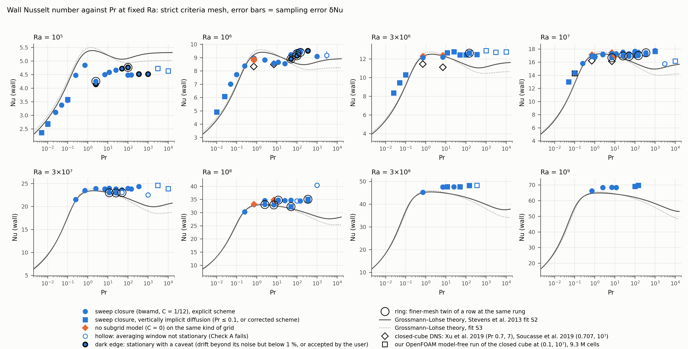{width="100%"}

::: {.cap}
Figure 1. Nu_wall against Pr at eight Ra for every current-settings strict row with a record long enough for a verdict (judge table of 2026-10-26). Circles: the closure with the explicit scheme; squares: vertically implicit diffusion where it carries no bias; orange diamonds: no-model controls; filled: stationary window; dark edge: stationary with a caveat; ring: finer-mesh twin; error bars δNu. Grey line: GL fit S2, dotted: fit S3; open black diamonds: closed-cube direct simulations (Xu et al. 2019, Soucasse et al. 2019); open black square: the group's OpenFOAM model-free closed cube at (0.1, 10⁷).
:::
::::
:::: {.column width="40%" .evidence}
**Evidence** (stationary base rows at Pr ≥ 2.5). Ra 10⁷: Pr 2.5 to 1000 read 17.0 to 17.8 (±2.3 % about 17.4) while the fit falls from 17.26 to 14.95. Ra 10⁸: 34.4 to 34.7 from Pr 2.5 to 345 (±0.4 %) against 32.95 to 29.67. Ra 3×10⁷: 23.6 to 24.3 (Pr 2.5 to 345) against a fit falling by 11 %; Ra 3×10⁸: 47.5 to 48.2 (Pr 7 to 145.7) against 45.02 to 42.57.

Below Pr 2.5 the value falls: Pr 0.71 reads 3 to 4 % below the middle of the plateau at Ra 10⁷ and 10⁸. At Ra 10⁵ the rows from Pr 0.25 to 1000 form a plateau at 4.5 to 4.8 where the fit runs at 4.8 to 5.4; the accepted row at (2.5, 10⁵), 195, reads 4.14 and its refinement twin is pulled.

**Confidence.** High for the shape: one mesh rule, closure and window policy per Ra, and the finer-mesh twins lower the Pr 7 to 100 rows by similar amounts. The level of the plateau is mesh-dependent (finding 4). Register: P-H5 supported, M-H3 favoured over M-H2.

::: {.question}
**Question.** Is a Pr-independent plate flux above Pr ≈ 3 at Ra 10⁷ to 3×10⁸ what you expect for a cell of aspect ratio one? Which measurements or simulations at Pr ≥ 100 in a closed cell would you trust as an anchor for the level (Silano, Sreenivasan and Verzicco 2010; Horn, Shishkina and Wagner 2013; Li et al. 2021)?
:::
::::
::::::

## 2. The GL fit serves as a 3 % reference for this cell only at Pr 0.25 to 7 for Ra 10⁷ to 10⁹

:::::: {.columns}
:::: {.column width="58%"}
::: {.t55}
| Ra | Pr range | rows | Nu_wall/Nu_GL − 1 | reading |
|---|---|---|---|---|
| 10⁵ | 0.005 to 10⁴ | 18 (+2 not stationary) | −23 to −6 % (−12.6 to −10.8 %) | the fit is high at every Pr; the rows form a plateau at 4.1 to 4.8 from Pr 0.25 to 1000 |
| 10⁶ to 3×10⁶ | 0.01 to 0.1 | 7 | +11 to +26 % | the fit is low at the low-Pr end |
| 10⁶ | 0.25 to 25 | 7 | −7 to +1 % | within 3 % only at Pr 0.25 and 0.71 |
| 10⁶ | 50 to 1000 | 5 | +5 to +12 % | the rows above the roll boundary (finding 7) |
| 10⁷ | 0.25 to 11.7 | 17 | −2 to +2 % | the fit serves |
| 10⁷ | 25 to 10⁴ | 11 (+4 not stationary) | +2 to +19 % (+3.5 to +11.4 %) | the fit is low, growing with Pr; +2 to +7 % after horizontal refinement at Pr 25 to 100 |
| 3×10⁷ | 0.25 to 7 | 4 | +1 to +3 % | the fit serves |
| 3×10⁷ | 11.7 to 10⁴ | 6 (+3 not stationary) | +4 to +17 % (+12.1 to +23.0 %) | the fit is low |
| 10⁸ | 0.25 to 0.71 | 2 | −1 to +1 % | the fit serves |
| 10⁸ | 2.5 to 1000 | 7 (+2 not stationary) | +5 to +17 % (+11.4 to +41.6 %) | the fit is low; +0.4 and +0.8 % after horizontal refinement at Pr 2.5 and 7 |
| 3×10⁸ | 0.71 | 1 | 0 % | the fit serves |
| 3×10⁸ | 7 to 345 | 5 (+1 not stationary) | +6 to +13 % (+16.5 %) | the fit is low |
| 10⁹ | 0.71 to 7 | 3 | +2 to +6 % | within 3 % at Pr 0.71 only |
:::

::: {.cap}
Table 2. Range of Nu_wall/Nu_GL − 1 over the stationary strict base rows per Ra and Pr range (twins and controls excluded), with the number of rows; in parentheses the rows not yet stationary (report 04, Table 6, with the rows judged since).
:::
::::
:::: {.column width="42%" .evidence}
**Evidence.** The low-Pr side rests on (0.1, 10⁶) +11.3 %, (0.05, 10⁶) +17.4 %, (0.025, 10⁶) +17.8 %, (0.01, 10⁶) +14.2 %, (0.1, 3×10⁶) +12.5 %, (0.05, 3×10⁶) +21.6 % and (0.025, 3×10⁶) +26.3 %; the high-Pr side on the base rows of Table 1 and the Pr 345 to 10⁴ rows of Table 2 (2 to 19 % below the fit at Pr ≥ 25, Ra ≥ 10⁷); the Ra 10⁵ side on 17 stationary rows from Pr 0.005 to 10⁴, all 6 to 15 % below the fit, the accepted row 195 at −22.8 %, and 2 rows not yet stationary at 11 to 13 % below it.

**Confidence.** High as a description of the fit against these rows; the box offset (finding 3) and the mesh dependence (finding 4) move the level by a few per cent and do not change the map. Register row G-1.

::: {.question}
**Question.** The fit's coefficients were fitted mainly to data at Ra ≥ 10⁶ and Pr 0.7 to 7, with mercury at Pr 0.025 as the low-Pr anchor. Do you read the departures at Ra 10⁵ (near the onset of time dependence) and at Pr 0.01 to 0.1 as the fit being extrapolated, and which box or cube data at Ra 10⁵ to 10⁶ would you compare with instead?
:::
::::
::::::

## 3. The box reads 4 to 7.5 % above the closed-cube direct simulations at Pr 0.71, with and without the closure; the same grid as cube and as box differs by +3.6 %

::: {.t55}
| Ra | grid | closure row | no-model control | cube (Xu 2019) | GL S2 | closure vs cube | closure vs GL |
|---|---|---|---|---|---|---|---|
| 10⁶ | 32×32×64 | 8.93 ± 0.5 % (145); 8.95 ± 0.6 % (172) | 8.92 ± 0.5 % (148); 8.79 ± 0.6 % (171) | 8.33 | 9.21 | +7.2, +7.5 % | −3.0, −2.7 % |
| 3×10⁶ | 32×32×80 | 12.14 ± 0.5 % (174) | 12.29 ± 0.4 % (173) | 11.46 | 12.25 | +5.9 % | −0.9 % |
| 10⁷ | 48×48×96 | 16.96 ± 0.3 % (337); 16.87 ± 0.4 % (176) | 17.15 ± 0.4 % (175) | 16.22 (Soucasse 2019: 16.24) | 16.97 | +4.6, +4.0 % | 0.0, −0.6 % |
| 3×10⁷ | 64×64×144 | 23.47 ± 0.3 % (103) | — | — | 23.08 | — | +1.7 % |
| 10⁸ | 96×96×192 | 33.05 ± 0.2 % (271) | 33.20 ± 0.4 % (451) | — | 32.63 | — | +1.3 % |
| 3×10⁸ | 144×144×256 | 45.19 ± 0.3 % (161) | — | — | 45.05 | — | +0.3 % |
| 10⁹ | 192×192×384 | 66.15 ± 0.2 % (390) | — | — | 64.56 | — | +2.5 % |
:::

::: {.cap}
Table 3. The Pr 0.71 series on the strict mesh: closure rows and no-model controls (Nu_wall ± δNu, case), the closed-cube value of Xu et al. 2019, the GL fit, and the deviations of the closure row. Windows of 300 to 400 t_f; the control 148 averaged over [450, 850] t_f.
:::

:::::: {.columns}
:::: {.column width="55%" .evidence}
**Evidence.** The closure rows read +7.2 and +7.5 % above Xu et al. 2019 at Ra 10⁶ (two seeds), +5.9 % at 3×10⁶, +4.6 and +4.0 % at 10⁷; the no-model controls on the same grids +7.1 and +5.6 %, +7.3 % and +5.8 %, so the excess is not the closure's. The same-grid pair of no-model runs at (10, 10⁷), 64×64×48: the periodic box 16.98 ± 0.3 % against the closed cube 16.39 ± 0.6 %, +3.6 % with a combined error of 0.7 % (P-H2 falsified, just). The GL fit sits 4.5 to 10.7 % above the same cube points. Judged since revision 1 (numbers only): the closed-cube twins of the strict rows 337 at (0.71, 10⁷) and 154 at (7, 10⁷) read −2.8 % and −4.1 % against their periodic-box parents (cases 683 and 685, combined error 0.6 %).

**Confidence.** High for the numbers; the attribution is open: +3.6 % is the geometry, the remainder up to 7.5 % is bracketed between geometry and horizontal resolution (finding 4).
::::
:::: {.column width="45%"}
::: {.question}
**Question.** How much more heat do you expect a cell with a periodic span to carry than a closed cube at Ra 10⁶ to 10⁷, where the roll has no end walls and the side walls carry no kinetic layer along y? Do you know a measurement of that difference (Dabbagh et al. 2016 ran a periodic span at Pr 0.7; Kaczorowski and Xia 2013 and Foroozani et al. 2017 the closed cube), and would you take a closed-cube twin of one of our strict rows as the decisive test?
:::
::::
::::::

## 4. The horizontal cell governs the level of the wall flux; on the strict mesh, doubling the horizontal count still lowers Nu by 2 to 4.5 %

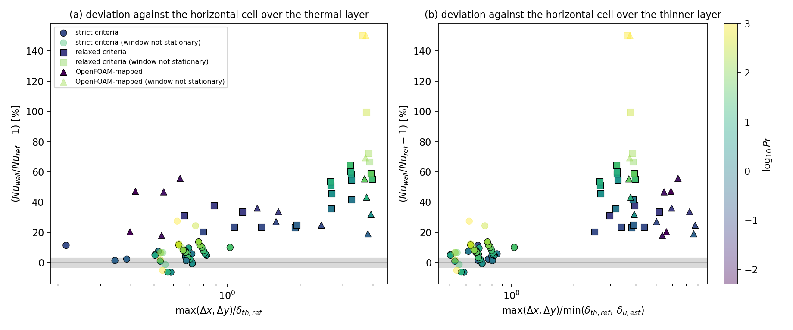{width="60%"}

::: {.cap}
Figure 3. Deviation of Nu_wall from the reference, in per cent, for every judged closure row at Ra ≥ 10⁶ on 2026-10-10 (report 03, Figure 1): (a) against the horizontal cell over the reference thermal layer, (b) against the horizontal cell over the thinner of the two reference layers. Circles: strict mesh; squares: relaxed mesh; triangles: OpenFOAM-mapped mesh; colour: log₁₀ Pr; filled with a black edge: stationary window; grey band ±3 %.
:::

:::::: {.columns}
:::: {.column width="55%" .evidence}
**Evidence.** Three mesh families with no row between them: 35 stationary strict rows at a median of +5.7 %, 19 relaxed rows at +41.6 %, 13 OpenFOAM-mapped rows at +33.7 %. Finer-mesh twins (Table 4, backup): horizontal twins lower Nu by 2.2 to 4.4 % at Pr 2.5 to 100, Ra 10⁷ to 10⁸, all beyond twice the combined sampling error; the vertical-only twin at (11.7, 10⁸) +0.6 %, within noise; the wall-cell twins at Ra 10⁶ −3.5 to −1.4 %. After horizontal refinement (2.5, 10⁸) and (7, 10⁸) sit within +0.4 and +0.8 % of the GL fit. No rung has a judged third horizontal level (the 192×192×160 row at (7, 10⁷) is running at t = 96.5 t_f): mesh convergence of the plate flux is not demonstrated.

**Confidence.** High for the direction and size of the effect; the mechanism (plumes of horizontal scale about one layer thickness, unresolved rather than modelled, M-H1) is a reading.
::::
:::: {.column width="45%"}
::: {.question}
**Question.** What horizontal resolution relative to δ_th do you consider converged for the plate flux in a cube at Ra 10⁷ to 10⁸ (Xu et al. 2019 and Soucasse et al. 2019 give their grids)? Our rule, a horizontal cell at most equal to the thinner layer, leaves a 3 to 4 % residual; is a rule of about a quarter of δ_th, at four times the cost, what you would ask of a simulation that claims 1 % on Nu?
:::
::::
::::::

## 5. The closure's whole effect on the wall flux is within ±2 % at every rung with a control, of either sign

:::::: {.columns}
:::: {.column width="52%"}
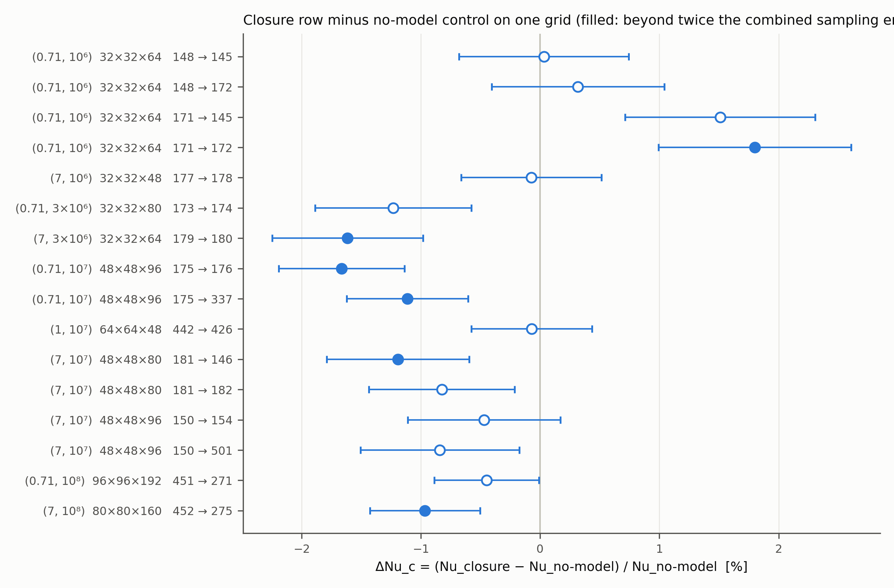{width="100%"}

::: {.cap}
Figure 2. Closure row minus no-model control on one grid, in per cent of the control, for the sixteen explicit pairs of the data report's Table 12 (judge table of 2026-10-26); error bars: combined sampling errors; filled: beyond twice that error. Label: (Pr, Ra), grid, pair of cases.
:::
::::
:::: {.column width="48%" .evidence}
**Evidence.** The closure changes Nu by −1.7 to +1.8 % on the sixteen pairs, beyond twice the combined error on six: negative at (0.71, 10⁷), (7, 3×10⁶), (7, 10⁷) and (7, 10⁸); positive only at (0.71, 10⁶), and there only against one of the two controls, which differ from each other by 1.5 % (8.92 against 8.79); a third control, judged since revision 1 (case 686, 8.88 ± 0.6 %), puts the two closure rows +0.5 and +0.8 % above it, within the combined errors of 0.8 and 0.8 %. Activity on the strict rows (report 05; Figure 8 in the backup): the bounded eddy viscosity is negative in 21 to 32 % of the volume; the net backscatter is 0.13 to 0.28 of the forward transfer where the roll exists; the closure's share of the kinetic dissipation is 0.11 to 0.15 at Pr 0.71 (Ra ≥ 10⁷), 0.05 to 0.06 at Pr 7 and 0.03 to 0.05 at Pr ≥ 25; the depth-mean eddy diffusivity is 0.12 to 0.18 κ from Pr 0.71 to 50.

**Confidence.** High for the size of the effect on these grids; the sign change with the grid (R1-H2) is weak, its positive branch resting on one of two controls. Register: P-H6 and H-3/5 falsified.

::: {.question}
**Question.** Our grids resolve the layers and hold a bulk cell of two to five Kolmogorov or Batchelor lengths, so a no-model run already carries most of the dissipation. Is a closure effect within ±2 % on Nu what you would expect there, and is there a regime in this cell where a minimum-dissipation closure should matter for the plate flux? At Pr ≥ 7 the model's active part is the eddy diffusivity: would you test a thermal closure there, or at low Pr?
:::
::::
::::::

## 6. The single roll of the box ends where the plane-mean wind Reynolds number falls to Re_w ≈ 2 to 4, at the same value for Ra 10⁶ to 10⁸

:::::: {.columns}
:::: {.column width="50%"}
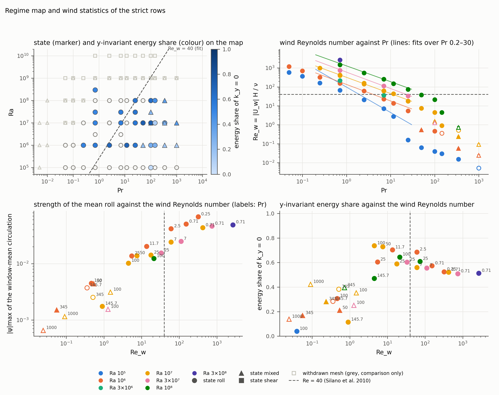{width="100%"}

::: {.cap}
Figure 4. Regime map and wind statistics of the strict rows (report 05, Figure 5; windows of 2026-10-13): top left, the (Pr, Ra) map with the ladder's state as marker and the y-invariant energy share as colour; top right, Re_w against Pr per Ra with power-law fits over Pr 0.2 to 30; bottom left, |ψ|max against Re_w (labels: Pr); bottom right, the y-invariant energy share against Re_w. Dashed: Re = 40 of Silano et al. 2010 in their peak-velocity definition.
:::
::::
:::: {.column width="50%" .evidence}
**Evidence.** Every row with Re_w ≥ 4.5 is a single roll ((1,1) share 0.79 to 0.96, |ψ|max 0.010 to 0.068, y-invariant energy share 0.52 to 0.74); every row with Re_w ≤ 1.5 a weak multi-cell flow (share 0.04 to 0.39, |ψ|max 0.0007 to 0.0045, energy share 0.11 to 0.42), at Ra 10⁶ to 10⁸ alike: a step, not a trend. In Pr the boundary lies between 25 and 50 at Ra 10⁶, at 100 at 10⁷, between 25 and 100 at 3×10⁷ and between 100 and 345 at 10⁸. Three seeds at (100, 10⁷) on one grid: two rolls (Re_w 4.8 and 3.6, no reversal in their windows) and one switching run (Re_w 2.7, four sign changes of U_w in 400 t_f). Over Pr 0.25 to 25 the wind scales as Re_w ∝ Pr^−0.84 to −0.87 (steeper than the −0.7 predicted, P-H3 falsified) and Ra^0.65; the boundary's Pr then grows as Ra^0.4 to 0.55, near Pr 300 to 900 at Ra 10⁹ (R5-H1).

**Confidence.** High for the boundary on the rows with two-dimensional output; the threshold value is a definition (a plane mean).

::: {.question}
**Question.** Silano et al. 2010 place the end of the wind regime at Re ≈ 40 in their peak-velocity definition; Li et al. 2021 report the breakdown of the circulation in a cube at Pr 146 to 345. Do our Re_w ≈ 2 to 4 and the Ra^0.4 to 0.55 growth of the boundary's Pr agree with what you know, and is a plane-mean wind a defensible criterion for a cell with a periodic span?
:::
::::
::::::

## 6 (continued). The mean circulation at Ra 10⁷ across Pr: a step from one roll to a weak multi-cell flow

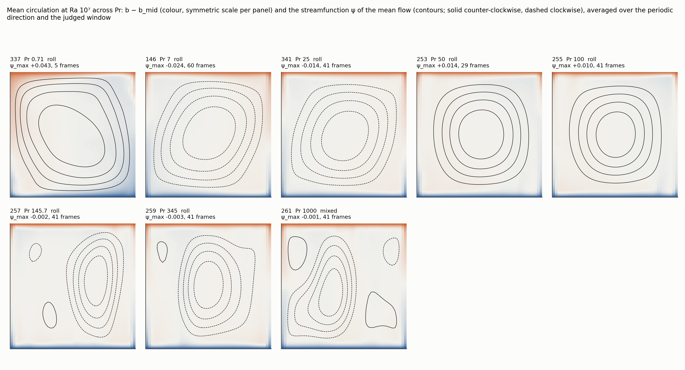{width="64%"}

::: {.cap}
Figure 5. Mean circulation at Ra 10⁷ across Pr (report 04, Figure 6b): the window-mean buoyancy minus its mid-plane value as the colour field, averaged along the periodic direction, with the streamfunction of the window-mean flow as contours (solid counter-clockwise, dashed clockwise). Each title gives the case, Pr, the ladder's state label, the extreme of the streamfunction and the number of 5 t_f frames in the window.
:::

::: {.small}
Below the boundary the wind never reversed in 300 to 1000 t_f on any row; above it the plane-mean wind changes sign one to five times per 100 t_f and its amplitude varies by 40 to 100 %. The kinetic energy of the mean flow falls by three to four orders of magnitude from Pr 0.25 to 1000 at Ra 10⁶.
:::

## 7. Across the roll boundary the wall flux is the same within about 1.1 % at Ra ≥ 10⁷, and 6 to 10 % higher above it at Ra 10⁶

::: {.t50}
| case | (Pr, Ra), grid | window (t_f) | Nu_wall ± δNu | state (share) | Re_w | reversals of U_w | Re_γ |
|---|---|---|---|---|---|---|---|
| 255 | (100, 10⁷), 48×48×80, seed 1 | [420, 820] | 17.52 ± 0.29 % | ROLL (1.00) | 4.8 | 0 | 18.5 ± 0.6 |
| 453 | (100, 10⁷), 48×48×80, seed 3 | [360, 760] | 17.45 ± 0.28 % | ROLL (0.91) | 3.6 | 0 | 12.5 ± 1.5 |
| 147 | (100, 10⁷), 48×48×80, seed 2 | [400, 800] | 17.65 ± 0.76 % | ROLL (0.70) | 2.7 | 4 | 7.9 ± 3.9 |
| 601 | (100, 10⁷), 96×96×160, twin of 255 | [200, 300] | 17.02 ± 0.58 % | ROLL (0.60) | 2.0 | 0 | 7.5 ± 2.6 |
| 225 | (25, 10⁶), 32×32×48 | [400, 800] | 8.54 ± 0.09 % | ROLL (1.00) | 5.5 | 0 | 14.1 ± 0.0 |
| 227 | (50, 10⁶), 32×32×48 | [560, 960] | 9.23 ± 0.25 % | ROLL (0.88) | 1.7 | 0 | 4.7 ± 1.0 |
| 463 | (50, 10⁶), 32×32×96, twin of 227 | [600, 1000] | 8.90 ± 0.01 % | ROLL (1.00) | 2.4 | 0 | 7.6 ± 0.0 |
| 229 | (100, 10⁶), 32×32×48 | [400, 800] | 9.44 ± 0.30 % | ROLL (0.95) | 0.8 | 0 | 2.4 ± 0.2 |
| 429 | (100, 10⁶), 32×32×96, twin of 229 | [100, 400] | 9.30 ± 0.09 % | ROLL (1.00) | 1.0 | 0 | 3.3 ± 0.0 |
| 231 | (145.7, 10⁶), 32×32×48 | [600, 1000] | 9.53 ± 0.18 % | ROLL (1.00) | 0.6 | 0 | 1.9 ± 0.1 |
| 464 | (145.7, 10⁶), 32×32×96, twin of 231 | [50, 350] | 9.39 ± 0.05 % | ROLL (1.00) | 0.7 | 0 | 2.2 ± 0.0 |
| 233 | (345, 10⁶), 32×32×48 | [1000, 1400] | 9.52 ± 0.08 % | ROLL (1.00) | 0.2 | 0 | 0.7 ± 0.0 |
| 235 | (1000, 10⁶), 32×32×48 | [600, 1000] | 9.09 ± 0.96 % | ROLL (0.74) | 0.0 | 0 | 0.1 ± 0.0 |
:::

::: {.cap}
Table 5. Seeds and states at (100, 10⁷) on one grid and the Ra 10⁶ rows on both sides of the roll boundary (each case's judge file): window, Nu_wall ± δNu, the ladder's state with the share of windows carrying it, Re_w, the number of reversals of U_w in the window, and Re_γ with its sampling error. The window of 255 is not stationary; 147 is judged on its valid record to t = 800.
:::

:::::: {.columns}
:::: {.column width="55%" .evidence}
**Evidence.** The three seeds at (100, 10⁷) read 17.45, 17.52 and 17.65, within 1.1 %, although one switches state; the rows above the boundary at Ra 10⁷ (Pr 145.7 to 1000: 17.50, 17.44 and 17.77) sit on the plateau. Seeds in one state agree to 0.2 to 0.3 %; at (25, 10⁷) a window holding 3 reversals reads 17.51 against 16.98 without one and the finer twin 16.96, so a window with reorientations can read 3.2 % high. At Ra 10⁶ the single rolls at Pr 0.25 to 25 read 8.38 to 8.95 (mean 8.69), the rows at Pr 50 to 345 9.23 to 9.53 on windows ending at 800 to 1400 t_f; the wall-refined twins (8.90, 9.30 and 9.39) lower them by 1.4 to 3.5 % and the horizontal twin of 229, judged since revision 1 (case 694, 64×64×48), by −3.1 %; neither closes the gap.

**Confidence.** High for the numbers; the reading of the Ra 10⁶ gap as a property of the flow without a wind (R5-H3) is one of two, the other that the 32×32×48 grid at Pr ≥ 50 is marginal in a way the twins do not test.
::::
:::: {.column width="45%"}
::: {.question}
**Question.** de Wit 2025 finds the large-scale vortex of rotating convection suppressing Nu by 3 to 8 % at matched steady states, and Gao et al. 2024 find the single-roll branch of two-dimensional convection carrying the higher flux. In a cube at Ra 10⁶ and Pr ≥ 50, is a plate flux 6 to 10 % higher without a roll than with one plausible to you, and what would you measure to decide whether the roll suppresses the flux there?
:::
::::
::::::

## 8. In the theory's own definition the roll's Reynolds number lies at 1.26 to 1.61 times the GL value at Ra ≥ 3×10⁸, growing as Ra^0.49 to 0.54

:::::: {.columns}
:::: {.column width="47%"}
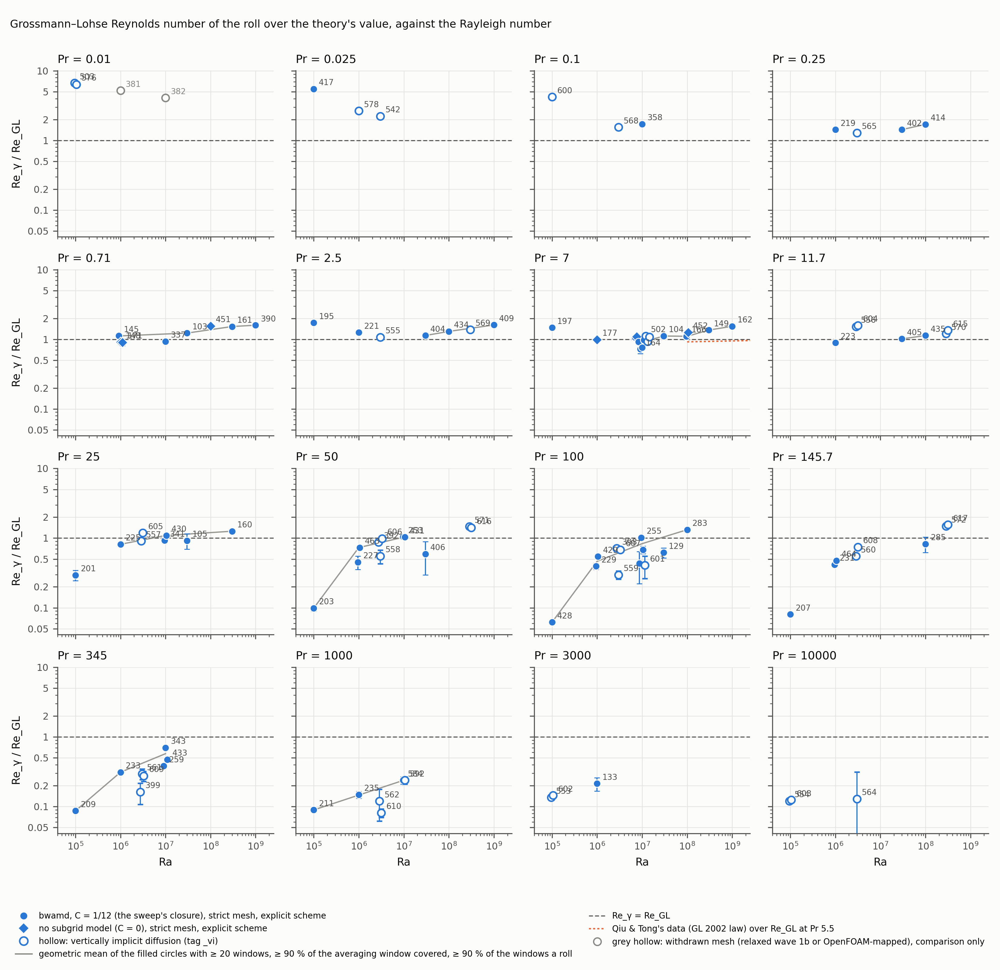{width="88%"}

::: {.cap}
Figure 7. Re_γ/Re_GL against Ra, one panel per Pr (data report, Figure C7b, build of 2026-10-21). Filled circles: the closure on the strict mesh, explicit scheme; diamonds: no-model controls; hollow circles: vertically implicit rows; grey hollow: withdrawn meshes. Grey line: geometric means of the rows with at least 20 complete windows, 90 % of the window covered and a roll in 90 % of the windows; dotted orange (Pr 7): Qiu and Tong's law over the theory. Error bars: sampling errors.
:::
::::
:::: {.column width="53%" .evidence}
**Evidence.** The ratio is 0.72 to 1.30 at Ra 10⁶ to 10⁸ (median 1.09, 17 rows at 0.7 ≤ Pr ≤ 25) and 1.26 to 1.61 at Ra ≥ 3×10⁸ (median 1.53, 6 rows): 1.53 at (0.71, 3×10⁸), 1.36 at (7, 3×10⁸), 1.26 at (25, 3×10⁸), 1.59 at (0.71, 10⁹), 1.61 at (2.5, 10⁹), 1.54 at (7, 10⁹), errors about 0.08. Fitted exponents over Ra ≥ 10⁶: 0.49 ± 0.01 (Pr 0.71), 0.54 ± 0.03 (2.5), 0.54 ± 0.02 (7), 0.54 ± 0.02 (25), each more than twice its error above the theory's 0.44 to 0.45, while Qiu and Tong 2001 stay within 6 % of the theory's trend over 10⁸ to 10¹⁰. At fixed Ra the ratio falls as Pr^−0.69 to −0.78 (theory −0.67 to −0.69). At Pr < 0.7 the ratio is 1.4 to 5.5. Three hypotheses are open (D-H6a to c): resolution (same-rung mesh pairs at Ra ≤ 10⁷ move Re_γ by −32 to +38 % in both directions); a roll without end walls (two-dimensional and thin-cell simulations give Ra^0.55 to 0.65, closed cylinders 0.43 to 0.46); a change of state at Ra ≈ 3×10⁸, not seen in the time means. Judged since revision 1 (numbers only): the periodic-length twins of (7, 10⁸) read +1.7 % (L_y = H/2) and −0.3 % (2H) in Nu against their parent; the H/2 twin of (7, 3×10⁸) reads +1.6 % with Re_γ 1.59 times its parent's, the direction D-H6b predicts.

**Confidence.** Medium: the level carries the geometry of the cell, so only the trend tests the theory, and the trend rests on three Rayleigh numbers above 10⁸ with one or two rows each.

::: {.question}
**Question.** For a roll that is periodic along its axis, what Ra exponent of the core shear rate would you expect, and would twins with a periodic length of H/2 and 2H at one rung convince you (D-H6b predicts the ratio to rise for H/2 and fall for 2H)? Is the GL Reynolds number meaningful at Pr ≤ 0.1, where our ratio reaches 1.7 to 5.5?
:::
::::
::::::

## 9. The thermal layer thins as Ra^−0.296; the kinetic layer follows 0.5 to 0.6 of the Prandtl–Blasius ratio up to Pr 7 and then stops growing with Pr

:::::: {.columns}
:::: {.column width="50%"}
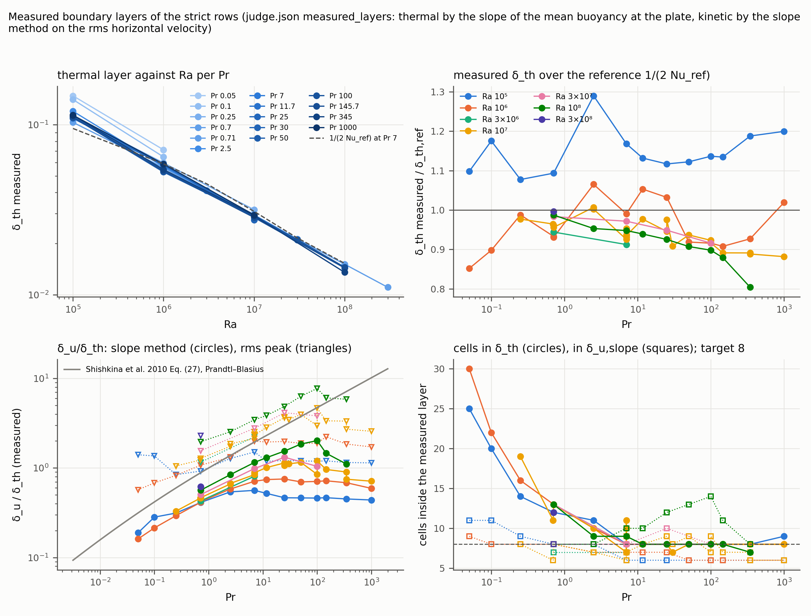{width="100%"}

::: {.cap}
Figure 6. Measured boundary layers of the strict rows (report 05, Figure 3): top left, δ_th against Ra per Pr, the reference layer at Pr 7 dashed; top right, measured over reference thermal layer against Pr per Ra; bottom left, δ_u/δ_th by the slope method (circles) and by the height of the velocity maximum (triangles), with the Prandtl–Blasius ratio of Shishkina et al. 2010 (grey); bottom right, cells inside the measured thermal (circles) and kinetic (squares) layers against the design target of 8.
:::
::::
:::: {.column width="50%" .evidence}
**Evidence.** The measured δ_th equals 1/(2 Nu_wall) to 0.1 % and thins as Ra^−0.296 ± 0.002 over Ra 10⁵ to 10⁸ at Pr ≥ 2.5, against the reference layer's −0.261. δ_u/δ_th by the slope method at Ra 10⁷: 0.33, 0.46, 0.67, 0.89, 1.01, 1.07 at Pr 0.25, 0.71, 2.5, 7, 11.7, 25, then 1.16 and 1.20 at Pr 50 and 100, and 0.96, 0.90, 0.71 at Pr 145.7, 345, 1000; Prandtl–Blasius gives 0.60 to 10.2 over the same Pr. At Ra 10⁸: 0.56 to 1.55 at Pr 0.71 to 25. The layer by the height of the velocity maximum saturates at 0.10 to 0.13 H at Ra 10⁶ to 10⁷ and 0.07 to 0.08 H at 10⁸. Over the 142 current strict rows the median δ_th/δ_u is 2.43 at Pr ≤ 1 and 1.24 at Pr ≥ 25. For the mesh: the Prandtl–Blasius sizing overestimates the developed kinetic layer by a factor 2 to 15 at Pr ≥ 7, so the runs hold 6 to 7 cells in it at Ra ≤ 10⁷ against the target 8.

**Confidence.** High for the measurements; the reading that the saturation is the loss of the wind (R5-H4) follows finding 6 and is untested.

::: {.question}
**Question.** How do you define the kinetic boundary layer at high Pr in a cell without a wind, and do your data show the saturation of its thickness that Silano et al. 2010 report at Re below 40? Does the Shishkina 2010 count rule for the kinetic layer apply where the velocity layer is set by the plumes rather than by a wind?
:::
::::
::::::

## 10. The weak mean gradient of the bulk changes sign with Pr: unstable at Pr ≤ 2.5, stable at Pr ≥ 100, the crossing between Pr 7 and 25

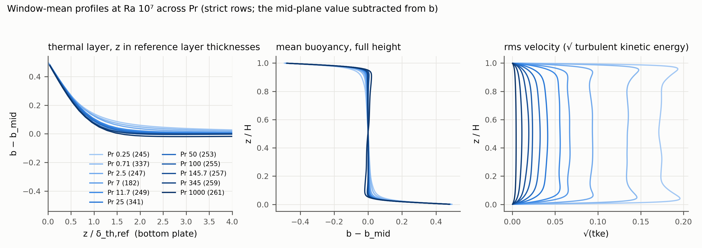{width="80%"}

::: {.cap}
Figure 9. Window-mean profiles of the strict rows at Ra 10⁷ across Pr (report 04, Figure 7a; light to dark with increasing Pr): left, the mean buoyancy minus its mid-plane value against the distance from the bottom plate in reference thermal-layer thicknesses; middle, the same over the full height; right, the root of the turbulent kinetic energy over the full height.
:::

:::::: {.columns}
:::: {.column width="55%" .evidence}
**Evidence.** Figure 9, middle: at Ra 10⁷ the buoyancy excess below mid-height is +0.02 to +0.03 of the plate-to-mid-plane difference at Pr ≤ 2.5 (an unstable mean gradient) and −0.01 to −0.02 at Pr ≥ 100 (a stable one); the same ordering holds at Ra 10⁸ from Pr 0.71 to 345 (report 04, Figure 7b). The thermal layers of all Pr collapse within about 20 % in reference-layer units; the root-mean-square velocity at mid-height falls monotonically from 0.19 at Pr 0.25 to 0.01 at Pr 1000, the near-plate maxima of the wind disappearing above Pr 25.

**Confidence.** High for the observation on these rows; its relation to the loss of the wind is a hypothesis (report 04).
::::
:::: {.column width="45%"}
::: {.question}
**Question.** Experiments in water have reported a weakly stable mean gradient in the bulk (Tilgner, Belmonte and Libchaber 1993), and the sign at lower Pr is less documented. Does the crossing we see between Pr 7 and 25 match what you know, and is it connected to the end of the roll?
:::
::::
::::::

## 11. At (0.1, 10⁷) two of our codes agree to 0.4 % on the plate flux and sit 13 % above the GL fit; at Pr ≤ 0.1 and Ra 10⁶ to 3×10⁶ the strict rows read 11 to 26 % above it

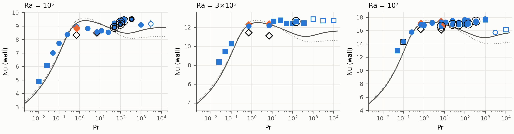{width="76%"}

::: {.cap}
Panels Ra 10⁶, 3×10⁶ and 10⁷ of Figure 1 (same markers: circles and squares the closure, orange diamonds no-model controls, open black diamonds closed-cube direct simulations, open black square the group's OpenFOAM model-free closed cube at (0.1, 10⁷); grey line the GL fit S2, dotted S3).
:::

:::::: {.columns}
:::: {.column width="55%" .evidence}
**Evidence.** Our strict row at (0.1, 10⁷), 112×112×224 cells, reads 14.36 ± 0.3 %; the group's OpenFOAM model-free closed cube at the same rung, 9.3 million cells, 14.30 ± 0.4 % over 400 t_f (an 85 times coarser model-free grid had moved it by only 1.1 to 1.3 %); the fit gives 12.76, the two-dimensional simulation of Gao et al. 2024 11.14. On the withdrawn meshes the low-Pr rows read 20 to 56 % high, so the rung is resolution-sensitive like every other, but the two resolved values of different codes and geometries agree. At Ra 10⁶ the rows at Pr 0.1 and 0.05 read +11 and +17 % against the fit, at 3×10⁶ +12 % at Pr 0.1, +22 % at Pr 0.05 and +26 % at Pr 0.025; at Ra 10⁵ the rows at Pr 0.005 to 0.25 read 6 to 9 % below it, except (0.1, 10⁵) at −15 % (refined twin −14 %).

**Confidence.** High for the numbers; the two codes share the group's choices (second-order centred schemes, the same mesh philosophy), so their agreement is not independent evidence against the fit.
::::
:::: {.column width="45%"}
::: {.question}
**Question.** Which low-Pr data at Ra 10⁶ to 10⁷ do you trust as anchors (Scheel and Schumacher 2017 at Pr 0.021 and 0.005 in a cylinder; Pandey, Scheel and Schumacher 2018 at Pr 0.005 to 0.7 in a wide layer; Zhang and Zhou 2024), and do you expect the GL fit to under-predict Nu by 10 to 25 % at Pr 0.01 to 0.1 in this Ra range?
:::
::::
::::::

## 12. Implicit vertical diffusion biased the plate flux by up to +6 % at Pr 1000 through a splitting error of the projection; the corrected scheme reproduces the explicit one to 10⁻⁴ %

:::::: {.columns}
:::: {.column width="55%"}
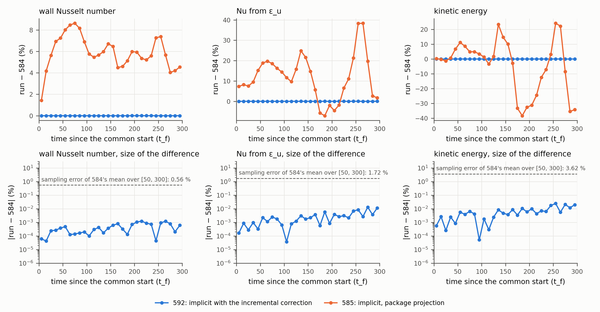{width="100%"}

::: {.cap}
Figure 10. Acceptance test of the corrected implicit scheme at (1000, 10⁷) (report 08, Figure 6). Top: run minus the explicit control 584, both from one field, mean of the matched trace rows per 10 t_f bin in per cent of the control's bin mean, for Nu_wall, the kinetic-dissipation Nusselt number and the kinetic energy; blue: implicit scheme with the incremental pressure correction (592); orange: implicit scheme with the package's projection (585). Bottom: the absolute difference of 592 from 584 on a logarithmic axis, the sampling error of 584's window mean dashed.
:::
::::
:::: {.column width="45%" .evidence}
**Evidence.** With the project's implicit no-slip wall row inside a non-incremental projection, the end-of-step velocity slips along the wall by about −Δt ∂ₓp, and the error grows with D_w = ν Δt/Δz_w²: a steady Stokes test gives +2, +8, +33 and +135 % in the wall shear at D_w = 0.25, 1, 4 and 16. At (1000, 10⁷) the implicit twin read +6.06 ± 0.44 % in Nu_wall against its explicit control over [50, 300] t_f (D_w 3.7; +7.7 % at the bottom plate, +3.1 % at the top). An incremental pressure correction removes it: the corrected twin reproduces the control to +0.00007 ± 0.0002 % at a step 24 times the explicit one. At Pr ≤ 0.1 the implicit rows step at D_w ≤ 0.3 and the bias is below 0.01 %, so they stand. The rows at Pr ≥ 7 on the biased scheme are held and rerun; of the sixteen reruns judged so far (200 to 400 t_f windows; the list is in report 09, finding 12), the stationary ones at Ra 3×10⁶ and Pr 11.7 to 145.7 lie within ±1.0 % of their biased predecessors except (25, 3×10⁶) at +4.6 %, (345, 3×10⁶) reads −4.4 %, and at Ra 3×10⁸ they read (11.7, 3×10⁸) −1.1 %, (50, 3×10⁸) −4.3 % and (145.7, 3×10⁸) −7.1 %, as report 08 expected from D_w; the seven not yet stationary, at Pr 1000 to 10⁴, scatter over −6.2 to +12.5 %.

**Confidence.** High: the mechanism is demonstrated by known-answer tests and by the three-dimensional acceptance twin.

::: {.question}
**Question.** Does your group step the vertical diffusion implicitly inside a projection scheme at high Pr, and if so, with an incremental pressure correction? Has a plate-asymmetric bias of this kind been seen elsewhere?
:::
::::
::::::

## Table 1. Wall Nusselt number on the base strict row of each rung, with the GL fit and the finer-mesh twins

::: {.t50}
| Pr | Ra 10⁶ | Ra 10⁷ | Ra 3×10⁷ | Ra 10⁸ |
|---|---|---|---|---|
| 0.05 | 7.02 ± 0.4 % (80×80×144, 351); GL 5.98 | — | — | — |
| 0.1 | 7.73 ± 0.4 % (64×64×112, 217); GL 6.94 | 14.36 ± 0.3 % (112×112×224, 358); GL 12.76 | — | — |
| 0.25 | 8.38 ± 0.5 % (48×48×80, 219); GL 8.28 | 15.79 ± 0.3 % (80×80×160, 245); GL 15.43 | 21.53 ± 0.3 % (112×112×224, 402); GL 21.25 | 30.27 ± 0.2 % (160×160×288, 414); GL 30.54 |
| 0.71 | 8.93 ± 0.5 % (32×32×64, 145); GL 9.21 | 16.96 ± 0.3 % (48×48×96, 337); GL 16.97 | 23.47 ± 0.3 % (64×64×144, 103); GL 23.08 | 33.05 ± 0.2 % (96×96×192, 271); GL 32.63 |
| 1 | — | 16.91 ± 0.4 % (96×96×96, 444); GL 17.16 | — | — |
| 2.5 | 8.82 ± 0.4 % (32×32×48, 221); GL 9.39 | 17.22 ± 0.3 % (48×48×80, 339); GL 17.26 | 23.87 ± 0.3 % (64×64×112, 404); GL 23.40 | 34.57 ± 0.3 % (80×80×160, 273); GL 32.95; twin 33.08 ± 0.3 % (160×160×192, 434) |
| 7 | 8.57 ± 0.4 % (32×32×48, 178); GL 9.24 | 17.35 ± 0.3 % (48×48×96, 154); GL 17.05; twin 16.69 ± 0.6 % (96×96×160, 164) | 23.83 ± 0.4 % (64×64×112, 104); GL 23.16 | 34.45 ± 0.3 % (80×80×160, 275); GL 32.67; twin 32.92 ± 0.5 % (128×128×256, 166) |
| 11.7 | 8.66 ± 0.3 % (32×32×48, 223); GL 9.11 | 17.28 ± 0.4 % (48×48×80, 249); GL 16.88 | 23.96 ± 0.3 % (64×64×112, 405); GL 22.96 | 34.53 ± 0.3 % (80×80×144, 277); GL 32.43; twin 34.72 ± 0.3 % (80×80×288, 435) |
| 25 | 8.54 ± 0.1 % (32×32×48, 225); GL 8.91 | 17.51 ± 0.3 % (48×48×80, 251); GL 16.56; twin 16.96 ± 0.3 % (96×96×160, 430) | 23.81 ± 0.3 % (64×64×112, 105); GL 22.59 | 34.57 ± 0.3 % (80×80×144, 279); GL 32.00 |
| 50 | 9.23 ± 0.2 % (32×32×48, 227); GL 8.71; twin 8.90 ± 0.0 %* (32×32×96, 463) | 17.28 ± 0.4 % (48×48×80, 253); GL 16.22; twin 16.90 ± 0.4 % (96×96×160, 431) | 23.61 ± 0.4 % (64×64×112, 406); GL 22.18 | 34.71 ± 0.3 % (80×80×144, 281); GL 31.51 |
| 100 | 9.44 ± 0.3 % (32×32×48, 229); GL 8.54; twin 9.30 ± 0.1 % (32×32×96, 429) | 17.52 ± 0.3 %† (48×48×80, 255); GL 15.85; twin 17.02 ± 0.6 % (96×96×160, 601) | 23.92 ± 0.3 % (64×64×112, 129); GL 21.70 | 34.44 ± 0.4 %† (80×80×144, 283); GL 30.93 |
| 145.7 | 9.53 ± 0.2 % (32×32×48, 231); GL 8.49; twin 9.39 ± 0.1 % (32×32×96, 464) | 17.50 ± 0.4 % (48×48×80, 257); GL 15.63 | 23.80 ± 0.3 % (64×64×112, 407); GL 21.43 | 34.44 ± 0.3 % (80×80×144, 285); GL 30.57 |
| 345 | 9.52 ± 0.1 %* (32×32×48, 233); GL 8.50 | 17.44 ± 0.5 % (48×48×80, 259); GL 15.19 | — | 34.59 ± 0.3 % (80×80×144, 287); GL 29.67 |
| 1000 | 9.09 ± 1.0 % (32×32×48, 235); GL 8.67 | 17.77 ± 0.5 % (48×48×80, 261); GL 14.95 | 22.50 ± 1.1 %† (64×64×96, 130); GL 20.08 | — |
:::

::: {.cap}
Table 1. Nu_wall ± δNu (grid N_h×N_h×N_z, case) on the base strict row of each rung at Ra 10⁶, 10⁷, 3×10⁷ and 10⁸, the GL fit S2 at the rung, and the finer-mesh twin where one is judged (twin − parent in Table 4). † marks a window that is not stationary, * a window that passes Check A with a caveat.
:::

## What the hypothesis register now says

::: {.xsmall}
- **M-H3 favoured over M-H2.** The growth of the deviation from the fit with Pr is the fit's Pr dependence, not a trend of the simulations (finding 1); what resolution still owes is the level of the plateau, which the horizontal twins move by 2 to 4.5 % (finding 4). A third horizontal level at one rung would say whether the level converges.
- **P-H2 and the box offset.** The periodic span adds +3.6 % to the plate flux on one grid at (10, 10⁷); the full excess over the cube at Pr 0.71 is 4 to 7.5 %; the closed-cube twins 683 and 685 (−2.8 and −4.1 %) are reported as numbers in report 09 revision 2. The remainder, 0.5 to 4 %, is of the size of the horizontal-cell effect, so a closed-cube twin of a strict row would separate the two. Hypothesis: the roll itself, which in the periodic box turns faster than in the cube (finding 8), sweeps the plates harder.
- **R1-H2 weakened.** The closure's sign change between grids rests on one of two controls at (0.71, 10⁶), which disagree by 1.5 %; the third control 686 (judged since) puts the positive branch within noise. A more general reading (hypothesis, from the ocean study of the same code): with an energy-conserving scheme a no-model run can only dissipate molecularly, and its excess of grid-scale energy over a resolved spectrum scales as (Δ/η)^4/3, about six on these grids; the closure then has little to remove, which is why its effect on Nu is within 2 % and why coarser grids fail through the unresolved plumes rather than through missing dissipation.
- **R5-H1 to R5-H5.** R5-H1 (the boundary at Re_w ≈ 2 to 4 for every Ra) is consistent with four Rayleigh numbers and predicts Pr ≈ 300 to 900 at Ra 10⁹, where rows at Pr 50 to 1000 are running. R5-H2 (bistability over a band of Re_w, lifetimes of order 300 to 400 t_f) is supported by the three seeds. R5-H3 (the flux indifferent to the state at Ra ≥ 10⁷, sensitive at 10⁶) is supported at Ra 10⁷ by the seeds and at Ra 10⁶ by the long windows and the wall-refined twins, with the marginal-grid alternative open. R5-H4 (the kinetic-layer saturation is the loss of the wind) is untested; a vertical-only refinement at (100, 10⁷) would separate it from resolution. R5-H5 (at Pr ≥ 7 the closure acts through the eddy diffusivity) is untested; a twin with ν_e kept and κ_e set to zero would test it.
- **D-H6a to D-H6c (the roll above the theory's trend).** Open. The dependence on Ra favours a roll without end walls (D-H6b); the mesh pairs at Ra ≤ 10⁷ neither support nor exclude resolution (D-H6a); a change of state (D-H6c) is not seen in the time means. The twins with a periodic length of H/2 and 2H were submitted on 2026-10-23; three are judged (finding 8).
- **H-6 (large-scale organisation) quantified.** Seeds in one state agree to 0.3 %, seeds in different states at (100, 10⁷) differ by 1.1 %, and a window holding reversals read 3.2 % high at (25, 10⁷). Any comparison claiming better than 3 % therefore shows the state of both runs.
:::

## Limitations

- **References are the weakest link**: no closed-cell simulation at Pr ≥ 25 or Pr ≤ 0.1 is available at our rungs, and the fit's own spread (fits S2 and S3) is 1 to 9 % there.
- **Mesh convergence of the plate flux** is shown to one level of horizontal refinement at five rungs and to none at Ra ≥ 3×10⁸.
- **The windows at Pr ≥ 345 hold few independent samples**: the integral time is about 28 t_f, so 200 t_f hold only four, and those windows are longer.
- **The state label of the ladder** rests on the antisymmetry of one profile; the boundary of finding 6 rests on the rows with two-dimensional output (24 rows in report 05).
- **The corrected implicit reruns are in flight**: the high-Pr rows at Ra 3×10⁶ to 3×10⁸ that carry squares in Figure 1 rest on 200 to 400 t_f windows.
- **One closure, one constant, one box**; the closed-cube twins judged since revision 1 are reported as numbers only.

## Conclusions, and what we propose to run next

::: {.small}
The sweep gives, on resolved meshes with sampling errors below 1 %, a plate flux independent of Pr above Pr ≈ 2.5 from Ra 3×10⁶ to 3×10⁸, a map of where the GL fit serves for this cell, a roll boundary at a fixed wind Reynolds number with the flux unchanged across it at Ra ≥ 10⁷, a kinetic layer that saturates with Pr, and a core shear rate above the theory's trend at Ra ≥ 3×10⁸. The level of the flux is known to a few per cent and is set by the horizontal cell and the geometry, not by the closure.

The next runs, on which we would value your view of priorities, were submitted on 2026-10-23 (report 10, Table 5):

1. Closed-cube twins of the strict rows at (0.71, 10⁷) and (7, 10⁷), to measure the box offset on the resolved mesh (finding 3): two judged, one finished and not yet judged.
2. A third horizontal level at (7, 10⁷), 192×192×160, to test the convergence of the plateau (finding 4): running at t = 96.5 t_f.
3. The periodic-length twins at (7, 10⁸) and (7, 3×10⁸) for the roll's Reynolds number (finding 8): three judged, one running.
4. A second seed of the no-model control at (0.71, 10⁶) (finding 5): judged.
5. The Ra 10⁹ rows at Pr 11.7 to 1000, running, which test the boundary's growth with Ra (finding 6), and the strict rows at Ra 10¹⁰ (Pr 0.71 explicit on 154 million cells, Pr 2.5 to 10⁴ on the corrected implicit scheme), which extend Figure 1 by a decade.
6. The refinement twins at (25, 3×10⁷), (145.7, 10⁷), (145.7, 10⁸), (7, 3×10⁸) and (1000, 10⁷), running, and the twin of the accepted row at (2.5, 10⁵).
7. The corrected implicit reruns at Pr 7 to 10⁴, which replace the held rows (sixteen judged, finding 12).
:::

## The cost of the next rungs on the corrected implicit scheme

:::::: {.columns}
:::: {.column width="58%"}
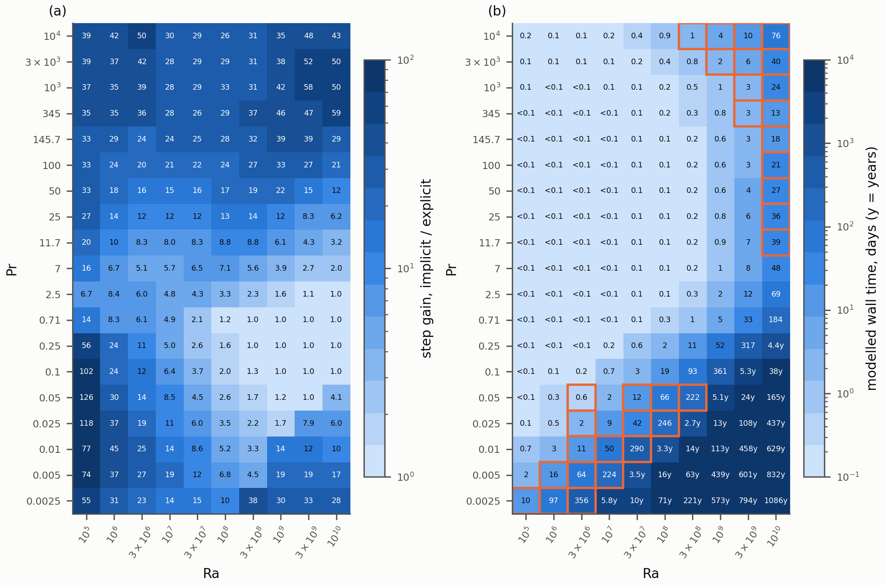{width="100%"}

::: {.cap}
Figure 11. (a) The time step of the vertically implicit scheme over that of the explicit scheme on the strict criteria mesh of each (Pr, Ra) rung, from the measured step model of report 07; (b) the modelled wall time of a rung on the current protocol (a coarse precursor plus a fine run of 250 to 300 t_f, threads by mesh size), in days; open squares mark the implicit frontier rows (report 07, Figure 1).
:::
::::
:::: {.column width="42%" .evidence}
- The Ra 10¹⁰ rows at Pr ≥ 11.7 take 13 to 76 days each.
- The low-Pr frontier below Pr 0.01 at Ra ≥ 10⁷ takes years.
- The explicit rows at Pr ≤ 0.25 and Ra ≥ 10⁹ sit at the advective limit, where the implicit step buys nothing.
::::
::::::

## The twelve questions

:::::: {.columns}
:::: {.column width="50%"}
::: {.xsmall}
1. Is a Pr-independent plate flux above Pr ≈ 3 at Ra 10⁷ to 3×10⁸ what you expect for a cell of aspect ratio one, and which Pr ≥ 100 data in a closed cell would anchor the level?
2. Are the departures from the GL fit at Ra 10⁵ and at Pr 0.01 to 0.1 the fit being extrapolated, and which box or cube data at Ra 10⁵ to 10⁶ would you compare with?
3. How much more heat should a periodic-span cell carry than a closed cube at Ra 10⁶ to 10⁷, and would a closed-cube twin of a strict row be the decisive test?
4. What horizontal resolution relative to δ_th is converged for the plate flux at Ra 10⁷ to 10⁸: about a quarter of δ_th at four times the cost?
5. Is a closure effect within ±2 % on Nu expected on grids with a bulk cell of two to five Kolmogorov or Batchelor lengths, and where should a minimum-dissipation closure matter?
6. Do Re_w ≈ 2 to 4 and the Ra^0.4 to 0.55 growth of the boundary's Pr agree with Silano et al. 2010 and Li et al. 2021, and is a plane-mean wind a defensible criterion?
:::
::::
:::: {.column width="50%"}
::: {.xsmall}
7. Is a plate flux 6 to 10 % higher without a roll than with one plausible at Ra 10⁶ and Pr ≥ 50, and what would decide whether the roll suppresses the flux?
8. What Ra exponent of the core shear rate would you expect for a roll periodic along its axis, and would periodic-length twins (H/2, 2H) convince you? Is Re_GL meaningful at Pr ≤ 0.1?
9. How do you define the kinetic boundary layer at high Pr without a wind, and does the Shishkina 2010 count rule apply where the plumes set the velocity layer?
10. Does the bulk-gradient crossing between Pr 7 and 25 match what you know, and is it connected to the end of the roll?
11. Which low-Pr data at Ra 10⁶ to 10⁷ do you trust as anchors, and do you expect the GL fit to under-predict Nu by 10 to 25 % at Pr 0.01 to 0.1?
12. Does your group step the vertical diffusion implicitly inside a projection scheme, with an incremental pressure correction, and has a plate-asymmetric bias been seen elsewhere?
:::
::::
::::::

::: {.small .muted}
Report 09 (revision 2, 2026-10-26) with the full evidence: `31_pr_ra_sweep/09_findings_for_collaborator_2026-10-22/REPORT.html` (link in its `PUBLISHED.txt`).
:::

## Backup. Table 4: finer-mesh twins of strict rows

::: {.t55}
| rung | parent → twin | refinement | twin − parent | combined error |
|---|---|---|---|---|
| (7, 10⁷) | 48×48×96 (154) → 96×96×160 (164) | horizontal ×2, vertical ×1.7 | −3.8 % | 0.7 % |
| (7, 10⁷) | 48×48×80 (146) → 96×96×160 (164) | horizontal ×2, vertical ×2 | −3.2 % | 0.7 % |
| (25, 10⁷) | 48×48×80 (251) → 96×96×160 (430) | uniform ×2 | −3.2 % | 0.4 % |
| (50, 10⁷) | 48×48×80 (253) → 96×96×160 (431) | uniform ×2 | −2.2 % | 0.5 % |
| (100, 10⁷) | 48×48×80 (255) → 96×96×160 (601) | uniform ×2 | −2.9 % | 0.7 % |
| (2.5, 10⁸) | 80×80×160 (273) → 160×160×192 (434) | horizontal ×2 | −4.3 % | 0.4 % |
| (7, 10⁸) | 80×80×160 (275) → 128×128×256 (166) | horizontal ×1.6, vertical ×1.6 | −4.4 % | 0.6 % |
| (11.7, 10⁸) | 80×80×144 (277) → 80×80×288 (435) | vertical ×2 (bulk) | +0.6 % | 0.4 % |
| (50, 10⁶) | 32×32×48 (227) → 32×32×96 (463) | vertical ×2 (wall cell halved) | −3.5 % | 0.3 % |
| (100, 10⁶) | 32×32×48 (229) → 32×32×96 (429) | vertical ×2 (wall cell halved) | −1.5 % | 0.3 % |
| (145.7, 10⁶) | 32×32×48 (231) → 32×32×96 (464) | vertical ×2 (wall cell halved) | −1.4 % | 0.2 % |
| (0.1, 10⁵) | 32×32×64 (189) → 64×64×128 (600) | uniform ×2 | +1.0 % | 0.2 % |
:::

::: {.cap}
Table 4. Parent and twin (grid, case), the refinement, twin − parent in per cent of the parent, and the combined sampling error √(δNu₁² + δNu₂²). Twin 601 runs the corrected implicit scheme of finding 12 on a 100 t_f window; twin 463 passes Check A with a caveat.
:::

::: {.small}
A difference is called resolved when it exceeds twice the combined sampling error (the data report's rule); every horizontal twin meets the data report's refinement rule (a twin that moves its parent by more than three combined errors calls for another level). Two hypotheses of the data report are not supported: a vertical bulk cell above the bulk scale does not lower Nu within noise (D-H1, pairs 277/435 and 443/444), and a kinetic-dissipation estimator below the wall value does not mark the resolution error (D-H3, 15 sequences).
:::

## Backup. Closure diagnostics of the strict rows

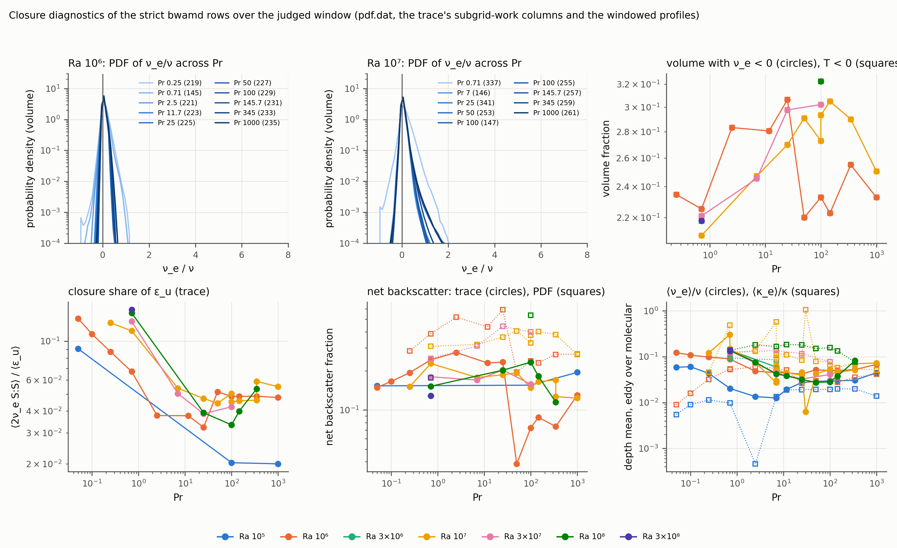{width="68%"}

::: {.cap}
Figure 8. Closure diagnostics over the judged window (report 05, Figure 7): top left and middle, the volume-weighted probability density of ν_e/ν at Ra 10⁶ and 10⁷ across Pr; top right, the volume fraction with ν_e < 0 (circles) and with a negative local subgrid transfer (squares); bottom left, the closure's share of the kinetic dissipation; bottom middle, the net backscatter fraction from the trace (circles) and from the transfer density (squares); bottom right, the depth means of ⟨ν_e⟩/ν (circles) and ⟨κ_e⟩/κ (squares).
:::
